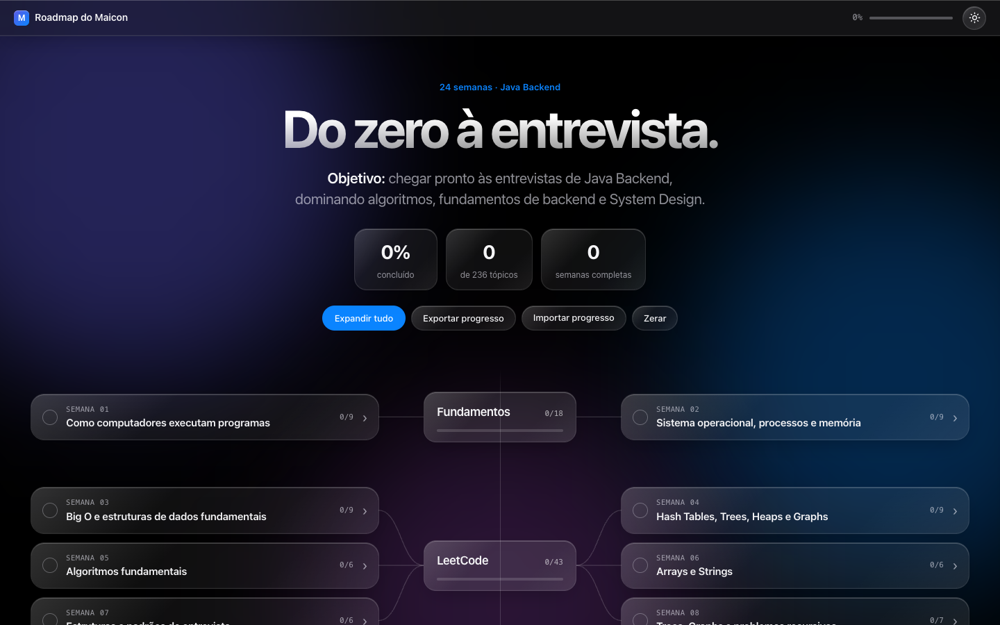
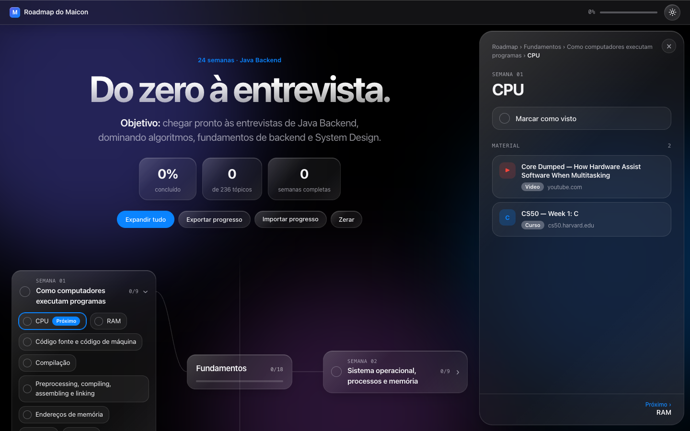

<div align="center">

# 🗺️ Roadmap do Maicon

**Do zero à entrevista: 24 semanas de estudo rumo a Java Backend.**

Um mapa interativo de estudos com progresso salvo, materiais por tópico e visual em vidro, com tema escuro e claro.


### 🌐 [Acessar o site → maicon-roadmap.vercel.app](https://maicon-roadmap.vercel.app)

</div>

<br>

<p align="center">
  
</p>

---

## 📌 Sumário

- [Sobre](#-sobre)
- [Funcionalidades](#-funcionalidades)
- [Conteúdo do roadmap](#-conteúdo-do-roadmap)
- [Tecnologias](#-tecnologias)
- [Estrutura do projeto](#-estrutura-do-projeto)
- [Como rodar localmente](#-como-rodar-localmente)
- [Deploy na Vercel](#-deploy-na-vercel)
- [Como editar os tópicos](#-como-editar-os-tópicos)
- [Créditos](#-créditos)
- [Autor](#-autor)

---

## 💡 Sobre

O **Roadmap do Maicon** organiza meus estudos para vagas de **Java Backend** em um mapa visual. São seis grandes áreas, que vão dos fundamentos de computação até System Design. Cada tópico tem materiais selecionados: vídeos, cursos e documentação.

O objetivo é simples: saber sempre **o que já estudei**, **o que vem a seguir** e **onde estudar cada assunto**.

🔗 **Site no ar:** https://maicon-roadmap.vercel.app

---

## ✨ Funcionalidades

| | Funcionalidade | Descrição |
|---|---|---|
| ✅ | **Progresso salvo** | Marque tópicos ou semanas inteiras; o progresso fica no `localStorage` do navegador |
| 🧭 | **Selo "Próximo"** | Destaca automaticamente o primeiro tópico ainda não estudado |
| 🗺️ | **Layout em mapa** | Seções no centro, ligadas às semanas por curvas |
| 📚 | **Painel de materiais** | Ao clicar num tópico, abre um painel com os links e a navegação anterior/próximo |
| 🔗 | **Links compartilháveis** | A URL acompanha o que está aberto, como `?topic=semana-01` ou `?topic=semana-01-cpu` |
| 🌗 | **Tema escuro e claro** | Escuro por padrão, com botão para alternar; a escolha fica salva |
| 💾 | **Exportar e importar** | Leve seu progresso para outro computador ou celular em um arquivo `.json` |
| 📱 | **Responsivo** | No celular o mapa vira uma coluna e o painel sobe de baixo, como um app |
| ♿ | **Acessível** | Respeita a opção "reduzir movimento" do sistema e tem rótulos para leitores de tela |

<p align="center">
  
</p>

---

## 📖 Conteúdo do roadmap

| Seção | Semanas | Tópicos | Foco |
|---|:---:|:---:|---|
| 🖥️ **Fundamentos** | 01 – 02 | 18 | CPU, memória, compilação, processos e threads |
| 🧩 **LeetCode** | 03 – 08 | 43 | Big O, estruturas de dados e padrões de entrevista |
| 🌐 **Backend** | 09 – 13 | 57 | Redes, HTTP, SQL, transações, segurança e produção |
| ☕ **Java Backend** | 14 – 17 | 52 | JVM, garbage collector, concorrência, Spring e JPA |
| 🔀 **Sistemas Distribuídos** | 18 – 20 | 32 | Kafka, mensageria, falhas e consistência |
| 🏗️ **System Design** | 21 – 24 | 34 | Escala, trade-offs e prática de entrevistas |
| | **Total** | **236** | |

**Principais fontes de estudo:** CS50 · Core Dumped · NeetCode · curso.dev · PlanetScale Learn · Inside Java · Spring Docs · Josh Long · Amigoscode · Confluent Developer · ByteByteGo · Exponent

---

## 🛠️ Tecnologias

- **HTML, CSS e JavaScript puros**: sem framework e sem etapa de build
- **CSS moderno**: `backdrop-filter` para o efeito de vidro, variáveis CSS para os temas, `color-mix` e `clamp`
- **SVG** gerado em tempo real para as curvas do mapa
- **localStorage** para o progresso e o tema
- **Vercel** para a hospedagem estática

---

## 📁 Estrutura do projeto

```
maicon-roadmap/
├── index.html   # página, estilos e lógica da interface
├── data.js      # semanas, tópicos e materiais (fonte dos dados)
├── docs/        # imagens usadas neste README
└── README.md
```

---

## 🚀 Como rodar localmente

Não precisa instalar nada. Basta abrir o `index.html` no navegador, ou subir um servidor simples:

```bash
git clone https://github.com/MaiconDouglas-dev/maicon-roadmap.git
cd maicon-roadmap
python3 -m http.server 5178
```

Depois acesse **http://localhost:5178**.

---

## ☁️ Deploy na Vercel

1. Acesse [vercel.com/new](https://vercel.com/new) e entre com o GitHub.
2. Importe o repositório `maicon-roadmap`.
3. Mantenha as configurações padrão (Framework: **Other**, sem build) e clique em **Deploy**.

A cada `git push` na branch `main`, o site é atualizado automaticamente.

---

## ✏️ Como editar os tópicos

Todo o conteúdo fica em [`data.js`](data.js).

**Adicionar um material** em `RESOURCES`:

```js
"meu-recurso": ["Nome do material", "video", "https://link-do-material"],
```

**Adicionar uma semana** em `WEEKS`:

```js
[25, "Java Backend", "Título da semana", [
  ["Nome do tópico", ["meu-recurso", "spring-docs"]],
]],
```

A seção é criada automaticamente a partir do nome da categoria. Para escrever a descrição dela, adicione a entrada em `SECTIONS`.

---

## 🙏 Créditos

A seleção de tópicos e materiais é baseada no roadmap do **[Ganeko](https://ganeko-roadmap.vercel.app)**, que gentilmente compartilhou o plano de estudos. Todo o crédito pela curadoria é dele.

---

## 👤 Autor

<table>
  <tr>
    <td align="center">
      <a href="https://github.com/MaiconDouglas-dev">
        <br>
        <b>Maicon Douglas</b>
      </a><br>
      <sub>Desenvolvedor Java em formação</sub>
    </td>
  </tr>
</table>

<div align="center">

Feito com ☕ e muita disciplina de estudo.

</div>
